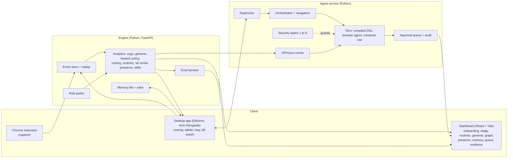
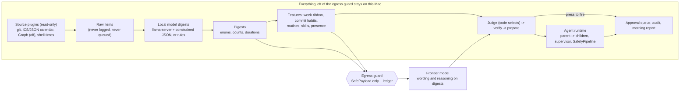

# Implementation spec

How to build Understudy. Requirements and IDs are in [SPEC_LIST.md](SPEC_LIST.md); this file says how. The reader is the coding agent on the build laptop. Everything here was written on Saturday 7 Nov 2026 at about 14:00 GMT, with submission due **Sunday 8 Nov 2026 12:00 GMT** and judging at 12:30. Run `date` first and plan backwards from the deadline.

## 1. What we are building

Understudy watches how people work on the same task, shows exactly where a novice loses time, coaches on the real screen, decides when to stay silent, nudge, teach or let an agent act, and fades its help as the person improves. A second layer (Handoff) finds repetitive routines in the logs, proposes automations that the worker opts into one by one, and runs them in the background or while the worker is away. A memory file the worker owns makes the system adapt to the person. The product is generalised across job roles through **role packs**.

It targets three challenges:

- **HRT**, best use of data for predictions and decisions: calibrated stuck and error prediction, review routing under a budget, ski-rental build timing, presence-window decisions, off-policy evaluation. Validity comes from baselines, held-out people, simulators with known truth and intervals.
- **G-Research**, make the invisible visible: the expert's decision policy as aligned traces and a transition graph; the worker's hidden routines and working rhythm as a graph and a heatmap; the failures of our own system as a limitations register.
- **Wordsmith**, the most complicated end-to-end browser-use workflow: parallel navigators, verifier, critic, approval gates, recovery, compiled routines, shadow mode, background and unattended runs, with an injection defence that is measured.

Honest framing for every screen and slide: validated on one deep role pack, with synthetic data plus four teammates. Do not claim novices become experts.

## 2. Ground rules for the build agent

1. Read [SPEC_LIST.md](SPEC_LIST.md) section 0 (locked decisions) before anything else.
2. Do not run, install or import code from `references/`. Read it only. Copy code only from the two MIT sources named in [REFERENCES.md](REFERENCES.md), and only with notices.
3. Never commit `.env`, keys or personal data. Never print the API key.
4. Keep a demo-able build at every checkpoint. If a checkpoint slips by more than one hour, apply the next cut in section 12.
5. Commit small and often. End every commit message with `Co-Authored-By: Claude Sonnet 5.5 <noreply@anthropic.com>`.
6. Write tests for every pure module before wiring it. Run the smoke test for a milestone before moving on.
7. Use subagents for independent tracks (section 10), one directory per agent, no shared files.
8. Human-only tasks (macOS permission prompts, the live study, submission) are listed in the README. Stop and ask the owner for those.
9. The UI follows [UI_DIRECTION.md](UI_DIRECTION.md). Look at the screen before calling a UI task done.

## 3. Architecture



All services run on localhost. Engine on `ENGINE_PORT` (default 7700), agent service on 7710, dashboard on 5173, sandbox calculators on 7801 to 7803. The desktop app and dashboard are clients of the engine. Mock mode (`UNDERSTUDY_MOCK=1`) replaces every model call with scripted outputs so the whole demo runs offline.

## 4. Repository layout

```
hacktheburgh-2026/
  README.md  CLAUDE.md  THIRD_PARTY_NOTICES.md  Makefile  .env.example  .gitignore
  docs/                       specs, board, UI direction, references, DECISIONS.md, SPIKES.md
  scripts/                    clone-references.sh, check-env.sh
  references/                 (gitignored) local copies of reference repos
  vendor/                     (committed) code copied from MIT sources, each file with a header
  apps/
    desktop/                  Electron app, started as a copy of Alongside (section 6.1)
    dashboard/                React + Vite + TypeScript
  extension/                  Chrome MV3 capture extension
  services/
    engine/understudy_engine/ store, personas, cogs, genome, hazard, policy, routing,
                              routines, presence, skills, trust, memory, packs, api, eval
    agent/understudy_agent/   supervisor, orchestrator, tiers, security, completion, compile,
                              shadow, queue, offhours, models, sandbox_sites, audit
  packages/
    schema/                   JSON Schemas (events, memory, packs, routines) + generated types
    packs/                    benefits-processor/, data-analyst/, programmer/
  evals/                      redteam/ pages, answer-key cases, study/ (plan, results)
  data/                       (gitignored) events, personas, routines, caches
```

## 5. Stack

- **Python 3.12** with `uv`. FastAPI, pydantic, numpy, pandas, scipy, scikit-learn, statsmodels, lifelines, pytest. Playwright (Python) for browsers. `openai` SDK. Avoid `pm4py` (AGPL, pandas pin clash) and `obp` (unmaintained since 2023); hand-roll the off-policy estimators.
- **TypeScript** for the desktop app (Alongside's stack: Electron, electron-vite, React, zod, vitest) and the dashboard (Vite, React, d3-force or Cytoscape.js for graphs; check licences).
- **Storage:** JSONL event files plus an in-memory index; SQLite only if needed. Memory is a Markdown file.
- **Versions** are not pinned here. Pin them in lockfiles on first install and record in `docs/DECISIONS.md`.

## 6. Contracts

### 6.1 Event schema v1 (`packages/schema/event.schema.json`)

```json
{
  "schema": 1,
  "id": "uuid",
  "t": "2026-11-07T14:03:11.123Z",
  "origin": "real | synthetic",
  "actor": "human | agent",
  "person": "p_9f3a",
  "role": "benefits-processor",
  "source": "browser | screen | os | desk | agent | coach",
  "type": "nav | click | scroll | focus | tab | copy | paste | search | idle | lock | unlock | sleep | resume | stuck | coach_shown | coach_followed | coach_dismissed | agent_step | approval | undo | task_start | task_end | progress",
  "target": { "role": "button", "label_hash": "h:9f2c", "domain_hash": "d:77aa" },
  "task_id": "t_204",
  "meta": { "depth_bin": 3, "len": 12, "tier": 1 }
}
```

Rules: no free text, no URLs, no field values. Labels and domains are hashed with a per-install salt. `meta` holds numbers and enums only. Synthetic rows must carry `origin: synthetic`; the store refuses to mix origins in one file.

**Two capture levels.** L0 is always on once the worker opts in, and hashed. L1 is per-routine, only after the worker opts that routine into recording: it also stores selectors and field names, with values replaced by parameter slots. It never records fields listed in `packages/schema/sensitive_fields.json` (password, pin, otp, card, national insurance and similar; keep this list as data).

### 6.2 Base cogs and role cogs

Base cogs: `READ`, `SEARCH`, `REFORMULATE`, `NAVIGATE`, `ENTER`, `COPY`, `PASTE`, `COMPARE`, `CHECK`, `DECIDE`, `IDLE`, `REVERT`, `ASK`. A role pack adds specialised cogs that map from base events (for the benefits pack: `ENTER_HOUSEHOLD`, `OPEN_CALCULATOR`, `READ_RESULT`, `CHECK_CLIFF`, `COPY_TO_NOTE`, `RECONCILE`). Mapping is rule-based and lives in the pack.

### 6.3 Role pack (`packages/packs/<id>/pack.yaml`)

```yaml
id: benefits-processor
version: 1
name: UK benefits processor
summary: Runs entitlement checks for households and writes the case note.
onboarding:
  questions:
    - id: tools        # which tools and sites do you use
    - id: risky        # which actions must never run without me
    - id: tone         # short or detailed
    - id: pace         # how fast do you want help to fade
    - id: hours        # usual working hours
cogs:
  extra: [ENTER_HOUSEHOLD, OPEN_CALCULATOR, READ_RESULT, CHECK_CLIFF, COPY_TO_NOTE, RECONCILE]
  mapping: mapping.yaml
expert_policy:
  steps: expert_steps.yaml        # ordered checks, with allowed reorderings
risk_classes:
  irreversible: ["submit", "send", "pay", "delete", "post"]   # patterns for labels
  sensitive_fields: sensitive_fields.json
routines: routines.yaml           # templates the finder can match
tone_defaults: { length: short, voice: plain }
curriculum: curriculum.yaml       # skills and the order to teach them
tasks: tasks/                     # household generator config and sandbox site config
oracle: oracle.py                 # entitlement scoring (PolicyEngine plus fallback)
persona: persona.yaml             # parameters for the synthetic persona generator
priors: priors.yaml               # role-level priors for pooling
plugin_refs: []                   # later: marketplace plugin ids (skills as procedures, MCP servers as tools)
```

The thin packs fill every key but `oracle`, `tasks` and full `expert_policy`. They must differ visibly in onboarding questions, cogs, risk classes and tone.

### 6.4 Memory file (`~/.understudy/memory.md`, path configurable)

```markdown
---
role: benefits-processor
revision: 12
---
## Preferences
- Summaries: short. Tone: plain.
## Procedure
- Usually checks child-related benefits first.   <!-- proposed 2026-11-07, accepted -->
## Routines
- calc-entry-3x  | rung A2 | consent: shadow+approval | unattended: allowed [none]
## Corrections
- (3 consistent corrections become a proposed rule; each rule is versioned)
## Skill state
- reads-error-first: L3, streak 2, last seen 2026-11-07
## Never
- banking sites, password managers
```

Writes use the learner store's rules (atomic, stale-revision rejected, the worker's edit wins, unknown sections kept). **Only the worker's own actions or approvals may write.** Page text, tool output and model text never write.

### 6.5 Routine and automation objects

```json
{ "id": "calc-entry-3x", "role": "benefits-processor",
  "episodes": 14, "minutes_per_week": 96, "cv": 0.18, "judgement_share": 0.07,
  "value": { "hours_saved": [3.1, 5.2], "net_gbp": [41, 90], "confidence": 0.82 },
  "touches": ["gov.uk check", "turn2us", "case note"], "never": ["submit"],
  "consent": { "mode": "shadow | approval | unattended", "irreversible_unattended": [], "typed_confirm": false },
  "rung": "A0 | A1 | A2 | A3",
  "bundle": "data/routines/calc-entry-3x/steps.json" }
```

**Bundles are a JSON step DSL, not generated Python.** Steps: `goto`, `click(selector|role+name)`, `fill(selector, param)`, `select`, `wait_for`, `assert_text(param|literal)`, `extract(name, selector)`, `checkpoint`. Each step has a `precondition` and `postcondition`. A small interpreter runs them in a separate Playwright context. Model-generated code is never executed.

## 7. Module specs

### 7.1 Engine

**`store/`** (CAP-2, CAP-3). `append(event)`, `read(partition, range)`, `fold(events) -> State` (pure), `replay(file, speed, squeeze_idle_s=30)`. Tests: same state from two replays; origin mixing refused; schema errors rejected.

**`personas/`** (CAP-9). A semi-Markov simulator per persona: states `ACTIVE`, `IDLE`, `AWAY`, `OFF`; weekday and hour dependent transition rates; log-normal dwell times; tasks per active hour; planted routines (name, daily Poisson rate, preferred hours, duration distribution, with parameter variation); stuck episodes whose hazard depends on a skill level that improves over the 21 days; a schedule change on day 15 (a night owl starts earlier), one sick day, one holiday; noise. Four personas: nine-to-five, night owl, shift worker, irregular. Output `data/synthetic/<persona>/events.jsonl` plus `truth.json` (schedule windows, routines and true parameters, stuck episodes, skill curves). Use a **different mechanism from the fitting models** so tests are not circular.

**`cogs/`** (ANA-1). `to_cogs(events, pack) -> list[Cog(t0, t1, id)]`; `segment_episodes(cogs, idle_s=60)`. A `progress` event is domain-defined (the benefits pack: a calculator result read, a note field completed). Tests on hand-made traces.

**`genome/`** (ANA-2 to 4).
- `align(a, b, cost)`: Needleman-Wunsch. Match 0; mismatch cost from a cog distance matrix (default 1, same family 0.5); gap 1. Convert to seconds: gap cost is the dwell of the unmatched cog; mismatch cost is the dwell difference. Reference: nearest expert by distance, or a consensus by progressive alignment.
- `placebo()` aligns expert against expert; `null()` shuffles labels. Both must show near-zero gap; report them.
- `decompose()`: regress task time on behaviour counts; Oaxaca-Blinder via `statsmodels` (verify the API); cluster bootstrap by person for intervals.
- `transition_graph(traces) -> nodes, edges`: cogs and transition frequencies; `diff(expert, novice)` lists edges the novice never takes.

**`hazard/`** (ANA-5). Discrete-time bins of 30 s. Label `y = 1` if no `progress` event occurs in the next 60 s. Features: last three cogs (hashed n-gram), dwell, repeated-action count, reformulations, time since progress, role prior. Model: logistic regression with person-level grouping. Split: **leave one person out**. Report log loss, Brier, expected calibration error and a reliability plot, beside two baselines: base rate and time-since-progress only.

**`policy/`** (ANA-6, ANA-7, COA-3, COA-4).
- Actions: `silent`, `nudge`, `annotate`, `takeover`.
- Rule baseline: promote a level after 3 clean runs; demote on 2 errors in the last 5; assisted runs move nothing. Dignity gate: act only after 2 consecutive stuck signals, then a cooldown; silent when unsure.
- Bandit: epsilon-greedy logging (epsilon 0.2) with propensities; reward = progress in the next 2 minutes minus interruption cost minus a reliance penalty on takeover. Implicit labels: a coach prompt followed within 10 s is "followed"; dismissed within 4 s is "dismissed"; the same issue recurring within 10 s is "repeated"; an undo within 10 s is "undone".
- OPE: IPS, self-normalised IPS and doubly robust: `V_DR = mean( q(x, pi(x)) + 1[a = pi(x)] / p(a|x) * (r - q(x, a)) )`. Hand-roll these.
- Simulator: contexts from synthetic traces, a reward model with known structure, a logging policy, a target policy. Compute the true target value by simulation and show that DR recovers it and the naive on-policy average does not. Bootstrap intervals.

**`routing/`** (ANA-8). Features: case complexity (household features), worker trace features (time, retries), worker-versus-agent disagreement, agent confidence. Calibrate (isotonic or Platt). Given a reviewer budget `k`, send the `k` highest-risk cases to the expert. **Risk control:** choose the largest auto-approved set whose Clopper-Pearson upper bound on the error rate is at most `alpha` on a calibration split, then check the bound on a held-out split. Output the risk-coverage curve and expert minutes per case. (MAPIE may help; check its current API before relying on it.)

**`routines/`** (ANA-10, ANA-11, HND-1, HND-7).
- Finder: segment episodes; distance = normalised alignment distance between cog sequences; agglomerative clustering (average linkage) with a threshold; minimum support 3. Score each cluster: count, minutes per week, coefficient of variation of duration, **judgement share** (searches, compares and decides divided by length). Match against the pack's `routines.yaml` templates.
- Forecast: negative-binomial or Poisson rate per routine with weekly seasonality, with an interval.
- Value: `hours_saved = forecast_runs * time_per_run`; `net = hours_saved * wage - build_cost - maintenance_risk - error_cost`. Use the wage as a parameter (YC's request cites $15 an hour as an example; treat it as an illustration).
- **Ski rental with predictions** for build timing: buy cost `b` (setup effort in units of one manual run), predicted remaining runs `y`, trust parameter `lambda` in (0,1). If `y >= b`, buy after `ceil(lambda * b)` runs; otherwise after `ceil(b / lambda)` runs. This is the Kumar, Purohit and Svitkina rule, 1 + 1/lambda robust and 1 + lambda consistent. **Verify the rule against the paper before relying on it.** Evaluate regret against the hindsight-best time and against break-even, on simulated workdays.
- Skill gate: a routine is eligible for automation only if the worker's mastery of its cogs is at level 4, or the pack marks it as not learning-relevant. Otherwise coach it.
- Proposal timing: propose only at episode boundaries, at most `N` per day; learn P(accept) per person from accepts and declines; a decline is a label.

**`presence/`** (ANA-12, OFF-1, OFF-3).
- Map: 672 bins per week (15 minutes). Per bin, a Beta posterior of "active", with the prior taken from the pack's hours and smoothed across adjacent bins and the same hour on other weekdays. Render with intervals; report "idle capacity" in hours per week.
- Window forecast: a return-time hazard conditioned on time of week and time already idle; use kernel-smoothed empirical survival of past idle spells. Output `S(D | t)`, the chance a window starting now lasts at least `D` minutes.
- Decision: **start a run of length `D` only if `S(D | t) > L / (G + L)`**, where `G` is the value of finishing and `L` the cost of a collision. This is the critical-fractile rule.
- Evaluate on held-out days: reliability curve and Brier score for `S`; interruption rate against a cap; share of idle time used; against two baselines (a fixed overnight window, and "run whenever idle five minutes").
- Real signal sources: idle seconds, lock, unlock, sleep and resume from the desktop app; activity counts from the extension. Real history comes only from CAP-8 times. Everything else is the synthetic persona.

**`skills/`** (ANA-13). Per-cog knowledge tracing with a forgetting term; output mastery in [0, 1] and a decay clock. The deterministic level engine (from Alongside) remains the authority; this feeds it.

**`trust/`** (HND-4, ANA-14). Wilson lower bound with `z = 1.96`. Ladder: `A0` observe, `A1` suggest and shadow, `A2` do with approval, `A3` do then report. Promote `A1 -> A2` after at least 20 shadow runs with lower bound at least 0.8 (20 clean runs give about 0.84). `A3` needs a lower bound of at least 0.95 (about 75 clean runs), so it is a target the demo does not reach; state that on screen. Demote one rung on any failure, an undo within seconds, or an injection-detector hit. Agent-claim calibration: a classifier for "claimed success but code check failed" from trace features, with a reliability plot.

**`memory/`** (MEM-1 to 5). Read and write the memory file under the rules in 6.4. Corrections become precedents; after three consistent corrections propose a rule (ceiling no looser than anything the worker already approved); a separate approval activates it; rules are versioned. A personal **procedure** rule activates only after a shadow comparison shows it matches expert-policy outcomes.

**`packs/`** (ROL-1 to 6). Loader, JSON Schema validation, CLI `understudy pack validate`. The loader accepts `plugin_refs` and does nothing with them yet.

**`api/`** (FastAPI). Endpoints: `GET /health`; `POST /events`; `GET /events`; `GET /replay`; `POST /onboarding`; `GET|PUT /memory`; `GET /genome/{task}`; `GET /graph/transitions`; `GET /hazard/{person}`; `POST /routines/detect`; `GET /routines`; `POST /routines/{id}/consent`; `POST /routines/{id}/shadow`; `GET /queue`; `POST /queue/{id}/approve`; `POST /queue/{id}/reject`; `GET /presence`; `POST /offhours/decide`; `GET /eval/report`; `POST /kill`. Document with OpenAPI.

**`eval/`** (ANA-15, EVL). `make eval` runs: deficit-recovery, null and placebo, hazard LOPO, OPE recovery, routing curve, ski-rental regret, presence calibration, agent-claim calibration and the red-team ablation, and writes `evals/report.json` that the Evidence page reads. Every metric carries its split and an interval, and synthetic results are labelled.

### 7.2 Agent service

**`supervisor.py`** (AGT-2). One worker, one replaceable pending request, a monotonically increasing generation, cancel events, deadlines and a watchdog. Results from an older generation are dropped. Stop is synchronous and does not depend on any model call. (The pattern is in the MIT VisionOS repo; copy only with notice, or write your own.)

**`orchestrator.py` and `navigator.py`** (AGT-1, AGT-5, AGT-7). The orchestrator turns a case into a task graph; N navigators run in parallel, each in its own Playwright context; a verifier checks a fresh observation; a critic compares evidence with the expert policy; a recovery step tries an alternate route and then escalates; the approval gate asks for a real click; the scribe writes the case note and evidence bundle. Step cap about 20 per navigator.

**`tiers/`** (AGT-3). Tier 1 runs a compiled DSL bundle. Tier 2 is a browser agent: Playwright with an accessibility snapshot and tool calls (Browser Use is an option). Tier 3 is computer use. Escalate only when a precondition fails; log the tier on every step.

**`completion.py`** (AGT-4). Code, not a model, decides success: the final observation must contain the goal tokens (for the benefits task: each calculator's result fields and the note id). A model "done" without this is recorded as a false claim.

**`compile.py` and `shadow.py`** (HND-3, HND-4). Turn an L1 recording into a DSL bundle (a model may draft; a validator checks every selector and parameter; a dry run on the sandbox site must pass). Shadow mode runs the bundle on the next real episodes without saving or submitting, compares its result to the worker's, and updates the Wilson bound.

**`offhours.py`** (OFF-1 to 7). Poll the engine's presence decision. If it says go and the screen is unlocked, start the checkpointed desktop run with keep-awake; abort within one second when idle time drops (the worker is back); write the morning report. Refuse to start when locked or asleep and show why.

**`security/`** (section 9). **`queue.py`** and **`audit.py`**: an approval queue with evidence bundles and an append-only redacted log.

**`sandbox_sites/`**. Three local calculator sites (ports 7801 to 7803) with different question flows and deliberately different logic on some inputs (cliff edges), plus a case-note page and an injected-instruction variant of each. They make the demo reliable, avoid terms-of-service problems, and give the red-team suite real pages. A shared `oracle.py` gives the reference answer (PolicyEngine UK when installed and usable, a simplified internal rule set otherwise).

### 7.3 Desktop app (`apps/desktop`)

1. Copy the owner's local Alongside tree from `ALONGSIDE_PATH` into `apps/desktop` **without** `.git`, `node_modules`, `assets/showtime/clips`, `docs/design-preview`, `docs/reports`. Keep `THIRD_PARTY_NOTICES.md` and every `Adapted from` header: they carry notices for code that is not the owner's.
2. Run it with `ALONGSIDE_MOCK=1` and confirm the dock and overlay start.
3. Put every model call behind the model port (section 8). Replace Gemini-specific services (grounder, verifier, architect, router, live voice) with port calls. Keep voice, wake word, scam analysis and files search **off** (feature flags); do not delete them yet.
4. Keep: overlay, level engine, learner store, verifier loop, agency policy and audit, agents runtime, mocks, design primitives.
5. Add: an engine client; DOM-based grounding (the extension sends element rects and window offsets, so rings land exactly on browser elements); idle, lock and sleep signals via `powerMonitor` (verify the API names); the kill switch hotkey; proposal toasts; a link to the morning queue.
6. Alongside's desktop click loop has **never executed a real click**. Do not build anything on it before spike S2 passes (section 10).

### 7.4 Dashboard (`apps/dashboard`)

Screens: Onboarding, Today (coach and current task), Routines (proposals, consent, rungs), Genome (ribbon, waterfall, transition graph, replay), Graph (work graph), Presence (heatmap), Memory (editable file view), Queue (morning approvals), Evidence. Follow [UI_DIRECTION.md](UI_DIRECTION.md). Graph interactions: nodes link when related, combine when two routines always run together and their alignment distance is small, and fade with disuse using the level engine's decay. Size is weekly minutes or mastery; colour is node type; opacity is strength. Click a node to see why it exists, edit it or delete it; deleting a memory node edits the memory file.

### 7.5 Extension (`extension/`)

MV3, content script plus service worker. Emit L0 events to `POST /events` on localhost. Capture element rects on request for the overlay. L1 recording only for a routine the worker opted in. Never read password fields or anything in `sensitive_fields.json`. Load unpacked; Playwright cannot automate extension loading the same way in headless mode, so use a headed persistent context for tests (verify).

## 8. Model provider port

The owner has an OpenAI key. Use it as the primary provider.

```python
class ModelPort(Protocol):
    def plan(self, messages, schema=None) -> dict: ...
    def read(self, untrusted, schema) -> dict: ...          # quarantined reader: no tools, schema output only
    def check(self, prompt, schema) -> dict: ...            # cheap verifier and classifier
    def vision(self, image, prompt, schema=None) -> dict: ...
    def computer_step(self, goal, screenshot, history) -> "Action | Done": ...
```

Providers: `openai_provider` (primary), `gemini_provider` (optional, only if a key exists), `mock_provider` (scripted, deterministic, per scenario). Environment variables: `OPENAI_API_KEY`, `OPENAI_MODEL_PLANNER`, `OPENAI_MODEL_FAST`, `OPENAI_MODEL_COMPUTER_USE`. **Never hard-code model names.** At boot, list the models the key can use; if a configured ID is missing, print the usable IDs and stop with instructions. Do not guess.

Computer use: the research found that the OpenAI Responses API has a computer tool that returns `computer_call` items with an actions list, and that pending safety checks must be acknowledged. **Verify the current request and response shape in the OpenAI documentation before writing the loop.** Treat any pending safety check as a stop that goes to the human queue. One action per turn, a fresh screenshot each time, a step cap, and a deadline. macOS screenshots are 2x: downscale (about 1280 by 720) and map coordinates back. If the computer tool is not available to the key, fall back to tier 2 for browser work and mark desktop runs as simulated in the demo.

Voice is off. A later option is OpenAI's realtime API; not in scope.

## 9. Security spec (SEC-1 to SEC-12)

There is no allowlist (D12). The optional worker denylist is checked before any navigation or app launch. The eight layers:

| Layer | Module | Behaviour |
|---|---|---|
| 1 Instructions apart from data | `security/sanitize.py` | Everything from a page, screenshot, file or tool result is wrapped as untrusted data; invisible characters removed; brackets neutralised so text cannot imitate system tags |
| 2 Quarantined reader | `security/reader.py` | `ModelPort.read` sees raw content and returns schema-checked fields; the planner never sees raw text |
| 3 Typed actions | `security/actions.py` | Fixed action set, validated arguments, one step at a time, fresh observation, step and time budgets |
| 4 Action-class gate | `security/gates.py` | Irreversible or outward-facing actions (send, post, submit, pay, delete, install, change permissions or credentials) need a human click, unless the worker opted that routine in for named classes (D11). Model-driven routines need a typed confirmation and a warning banner at opt-in; compiled routines need one tap |
| 5 Data-flow rules | `security/dataflow.py` | Values carry a taint tag (`web`, `file`, `memory`, `logged_in`). Tainted or personal data cannot be typed or uploaded to a site the routine did not record without a queued approval |
| 6 Injection detector | `security/detector.py` | Scan page text, hidden elements, alt text and OCR for text aimed at an AI (instructions, fake system banners, tool-call syntax). A hit pauses the run, is logged and lowers the rung. A hit is never a reason to act |
| 7 Goal-drift check | `security/drift.py` | A cheap model check asks whether each proposed step serves the stated goal; plus a stuck-loop detector (same action four times, or a 2 to 4 cycle three times) |
| 8 Protected settings | `security/settings.py` | Page content cannot write memory or change the denylist, consent, quiet hours or the kill switch; the agent cannot click them |

**Red-team suite** (`evals/redteam/`, SEC-12): hidden text, fake system banners, markdown-image exfiltration, tool-call mimicry, injection inside search results, PDFs and alt text, and multi-step attacks, each in a sandbox-site variant. Report attack success rate and task success under attack with each layer switched off in turn, plus the false-pause rate on clean pages, with intervals. Alongside's `fixtures/safety/injection.html` and its safety review notes are a starting set.

## 10. Milestones, order and parallel tracks

Hours are relative to the start (`T+0`). Recompute against the deadline. **Freeze features at deadline minus 4 hours** (08:00 Sunday). Every checkpoint must leave a runnable demo.

| Milestone | When | Output | Acceptance |
|---|---|---|---|
| **M0 Setup and spikes** | T+0 to 1 | Repo skeleton, `make` targets, references cloned, Alongside copied and running in mock mode | S1 to S4 below recorded in `docs/SPIKES.md` |
| **M1 Contracts and data** | T+1 to 4 | Schemas, event store and replay, persona generator, pack loader, benefits pack v0, sandbox sites and oracle, household generator | CAP-2, CAP-3, CAP-9, ROL-1; 20 households run through the oracle |
| **M2 Capture and coach shell** (parallel with M1) | T+1 to 5 | Extension to engine ingest; desktop app on the model port; overlay on DOM rects | CAP-1, CAP-4, COA-1, COA-2 |
| **M3 Analytics v0** | T+3 to 8 | Cogs, episodes, genome ribbon, null and placebo, hazard baseline, presence map, routine finder; ribbon and heatmap in the dashboard. **Checkpoint T+6: ribbon and heatmap render from synthetic data** | ANA-1 to 3, 5, 10, 12; VIS-1, VIS-4 |
| **M4 Coach loop and onboarding** | T+4 to 9 | Ladder, nudges, verification, onboarding to memory file, three packs | COA-3 to 5, ROL-2 to 4, MEM-1 |
| **M5 Agent workflow** | T+5 to 11 | Supervisor, orchestrator, navigators on the sandbox sites, tiers 1 and 2, completion check, approval gate, routing, security layers 1 to 5. **Checkpoint T+8: one household end to end** | AGT-1 to 7, ANA-8, SEC-1 to 5 |
| **M6 Handoff slice (full, per D7)** | T+9 to 14 | Proposal cards, consent, L1 recording, DSL compile, shadow mode, ladder, background run in a second context, morning queue, audit. **Checkpoint T+12: a planted routine goes from proposal to approved background run** | HND-1 to 8, ANA-11 |
| **M7 Off-hours live run (D8)** | T+12 to 17 | Presence-driven decision, desktop computer-use runner (after spike S2), keep-awake, kill switch, morning report; simulated-clock mode as the fallback | OFF-1 to 7 |
| **M8 Graphs and visuals** (parallel) | T+10 to 17 | Work graph, genome graph, replay, polish | VIS-2, VIS-3, VIS-5, VIS-7, VIS-9 |
| **M9 Evaluation** | T+14 to 19 | Deficit recovery, OPE recovery, routing curve, ski-rental regret, presence calibration, red-team ablation, analysis plan committed, live study with the four teammates, Evidence page | EVL-1 to 5, SEC-12, VIS-6 |
| **M10 Polish and submit** | freeze to deadline | Demo rehearsal twice, cached golden run, README with disclosures, notices, submission text | NFR-1, NFR-6, NFR-7 |

**Spikes in M0** (record results in `docs/SPIKES.md`):
- **S1** OpenAI: list models, one chat call, one vision call, one computer-tool probe. Decide which `OPENAI_MODEL_*` IDs to use.
- **S2** Real click: with the owner present to grant Accessibility and Screen Recording, perform one click and one text entry on TextEdit or Calculator through the chosen actuator (Alongside's actuator, or `cliclick` or AppleScript). Decide whether OFF-4 is real or simulated.
- **S3** Playwright: launch a headed persistent context with the extension loaded; capture one event.
- **S4** PolicyEngine UK: install in an isolated environment, check its licence file, compute one household. If unusable, use the internal rule set and say so.

**Parallel tracks** (one subagent each, no shared files): (A) `services/engine/**` analytics; (B) `apps/dashboard/**`; (C) `services/agent/**` and `apps/desktop/**` agent-facing code; (D) `extension/**`, `packages/**`, `evals/**`. The lead agent owns `docs/**`, the Makefile and merges.

## 11. Demo script (3 minutes) and fallback

1. **Onboarding, 30 s.** Pick "benefits processor" then "data analyst": different questions, cogs, risk classes and tone, written to the memory file.
2. **See the invisible, 30 s.** The genome ribbon, the gap waterfall with intervals, the placebo showing zero, and the transition graph with the missing edges highlighted.
3. **Coach, 40 s.** A teammate works a case; the ring lands on the skipped check; help is lighter on the next case.
4. **Automate, 40 s.** The routine card appears; the worker opts in; shadow mode matches; the agent runs it in the background while the worker handles the judgement part; one irreversible step lands in the queue.
5. **Away, 30 s.** The presence heatmap and window forecast; the worker walks away from an unlocked laptop; the desktop run starts, the worker returns, the agent yields and leaves a report.
6. **Proof, 20 s.** Evidence page: calibration, risk-coverage, off-policy recovery, injection table, limitations register (synthetic origin, n = 4).

Fallback: every step has a mock-mode and cached-run path. Record a full run on video before the freeze.

## 12. Cut lines and stop-loss

Apply in this order when a checkpoint slips by more than an hour:

1. Off-hours live run becomes a simulated-clock demo plus a recorded real run (keep the heatmap, window forecast and decision rule).
2. Genome graph becomes a static diagram (keep the ribbon).
3. Thin packs become configuration only (keep the onboarding difference).
4. Bandit becomes the rule baseline plus an expected-value table (keep OPE in the simulator if cheap).
5. Live study becomes simulation only, stated plainly.
6. Real-site calculators are dropped; sandbox sites only.

Never cut: the event store, the genome ribbon, the hazard with baselines, review routing, the security layers 1 to 5, the audit log, the limitations register, mock mode.

## 13. Verify at build time

These were researched but not confirmed. Check each and note the result in `docs/SPIKES.md`.

- OpenAI model IDs, computer-tool request and response shape, safety-check handling, rate limits.
- PolicyEngine UK licence (related PolicyEngine repositories are AGPL-3.0), install path and Scotland coverage.
- Public calculator terms and bot protection (not needed if sandbox sites suffice).
- Electron `powerMonitor` API names for idle time and lock events.
- macOS Accessibility and Screen Recording behaviour for an unsigned dev build.
- Ski-rental rule and robustness-consistency constants against the original paper.
- `statsmodels` Oaxaca-Blinder API, MAPIE API, library versions on Python 3.12.
- Whether OpenAdapt (MIT) is worth importing for record and replay; the DSL interpreter is the default.
- Graph library licences (d3-force, Cytoscape.js, Sigma.js).

## 14. Extensions architecture (REQ-2): "beyond the screen"

Requirements are in SPEC_LIST section 14. This section says how. Status: **proposed**; the order and scope are set by D27. Everything is behind flags (`UNDERSTUDY_X_*`), off by default, and the P0 demo path never imports it.

### 14.1 Layers and data flow



**Rule of thumb:** raw content is read only by code and the local model; the frontier model receives `SafePayload` objects and nothing else; code, not a model, selects which suggestion templates apply, which cards surface and what may fire.

### 14.2 Privacy and egress (PRV)

- Module `services/engine/understudy_engine/privacy/`: `payload.py` (`SafePayload`: a pydantic model whose fields are only `int`, `float`, `bool`, `Literal` enums, `list` of those, and ids matching fixed vocabularies; a `strict` validator rejects any other string), `bucket.py` (counts under 5 become `lt5`, times round to 15 minutes, durations to 5 minutes, ratios to 10% steps), `egress.py` (`send(purpose, payload, port)`: validate, bucket, scan with the PII/canary backstop, write the ledger line, then call the model port; the only function in the new layers that may reach `ModelPort.plan` or `.check` with content), `ledger.py` (append-only JSONL `data/egress_ledger.jsonl`: time, purpose, schema id, field names, the payload exactly as sent, model id; never raw source text because none can enter), `canary.py` (plants unique tokens in fixtures and scans captured request bodies).
- Existing limits stay: the quarantined reader, SEC-1 to SEC-12, no allowlists, protected settings. The ledger is exposed read-only at `GET /privacy/ledger` and `GET /privacy/summary` (counts by purpose, last call, "nothing else left this laptop" is **not** claimed: model calls for steps the worker asked for are listed too).
- Test strategy: a fake model port records every request body; the whole flow runs on fixtures seeded with canaries (a person's name, an email, a meeting title, a path, a commit message, a customer name); the assertion is zero canary hits and one ledger line per call.

### 14.3 Local model and digests (LOC)

- `services/engine/understudy_engine/localmodel/`: `server.py` (start, health and stop `llama-server` on a loopback port with the model path from `UNDERSTUDY_LOCAL_MODEL`; the binary is Homebrew `llama-server`), `client.py` (OpenAI-compatible `/v1/chat/completions` with a JSON schema or GBNF grammar), `digest.py` (task definitions: `commit_digest`, `event_digest`; each returns only fixed-vocabulary enums and numbers), `guards.py` (no-verbatim-span check with n-gram overlap, PII regex backstop, fail-closed on parse errors), `rules.py` (the deterministic fallback used when no model is present and in mock mode).
- Model choice (D25): Qwen2.5-7B-Instruct Q4_K_M (4.68 GB, Apache-2.0) from `bartowski/Qwen2.5-7B-Instruct-GGUF`, fits this Mac (arm64, 32 GB). Digest quality is evaluated against planted labels; fine-tuning is out of scope.

### 14.4 Plugins and sources (PLG)

Manifest `plugin.yaml` (pattern from the Clicky Hermes plugin): `id`, `kind: source|skill|tool`, `permissions: [read]`, `egress: local_only`, `schema`, `entry`. Source plugins implement `read(since) -> Iterator[RawItem]` and never write. Adapters: `git` (local repos through `git log` with numstat), `ics` (RFC 5545 files and a JSON export), `graph_outlook` and `graph_teams` (Microsoft Graph, off by default, needs the worker's own sign-in, aggregate-only, tested only against recorded fake responses), `shell_times` (CAP-8). Packs reference plugins through `plugin_refs`.

### 14.5 Calendar routine layer (CAL)

`services/engine/understudy_engine/calendar/`: `features.py` (weekly meeting load, focus blocks of 60 and 90 minutes, fragmentation index, back-to-back runs, recurring series, work-hours span, off-computer blocks), `expert.py` (expert routine templates from `packages/packs/<role>/routine_expert.yaml` and the gap analysis, reusing the genome's alignment on a day-slot sequence), `suggest.py` (the fixed suggestion catalogue; code selects, the model may only reword from safe aggregates), `synth.py` (synthetic calendars with planted structure and truth for the four personas and the experts). API: `GET /calendar/week?person=` (the week ribbon), `GET /calendar/suggestions?person=` (each with its numbers and the expert reference).

### 14.6 Proactive intelligence (PRO)

`services/engine/understudy_engine/proactive/`: `judge.py` (code ranks candidates from routines, skill gaps, calendar suggestions, git habits, agent results; at most 3 cards; "fewer, even zero"), `verify.py` (re-checks each candidate against current state and drops stale ones), `prepare.py` (builds the editable prepared content from templates; a model may reword through the egress guard), `cards.py` (card schema with risk class and source tags), `fire.py` (on the worker's press only: enqueue an approval item or start a background agent run, never both unprompted). API: `GET /briefing`, `POST /briefing/{id}/fire`, `POST /briefing/{id}/dismiss`. Design source: the owner's research notes on Sentient OS (judge, research and prepare, execute on press; at most five ready cards; stale items dropped), reimplemented in our own code and words.

### 14.7 Agent runtime (BGA)

`services/agent/understudy_agent/runtime/`: `spec.py` (`AgentSpec`: role, tools, budgets (steps, seconds, tokens), workspace kind (`tmp`, `worktree`, `none`), output schema, playbook), `parent.py` (plans through `ModelPort.plan` into child specs; code validates every spec against policy and budgets; max 4 children), `child.py` (runs one child through `SafetyPipeline` with typed tools: `read_file`, `list_dir`, `git_log`, `run_python` (a subprocess in an isolated tmp dir, no network, time and memory limits), `write_workspace`, `emit_result`), `tools.py`, `workspace.py` (isolated tmp dir or `git worktree add` on a copy; writes outside it are refused), `modes.py` (foreground: yield on human input; nightly: through `offhours.py` with the presence decision), `results.py` (typed results; code-checked completion; artifacts listed in the queue item). Exemplars in `runtime/exemplars/`: programming (commit analyst, test-gap finder, refactor suggester), data analysis (profiler, chart builder), creative (weekly write-up). Everything uses the existing supervisor, queue, audit, kill flag and consent files; no new trust paths.

### 14.8 Git analysis (GIT)

Programmer pack gains cogs `CODE`, `TEST`, `REFACTOR`, `COMMIT`, `REVERT` mapped from commit events (time, files, additions and deletions, test-touch, revert), synthetic repos with planted expert and novice habits (huge commits, no tests, fix-after-fix loops), and suggestions through the CAL-3 guard.

### 14.9 Milestones, order and cut lines (proposed; see D27)

| Wave | When (GMT) | Output |
|---|---|---|
| X1 | Sat 17:00 to 20:00 | Egress guard and ledger with canary tests; local model server and digest pipeline with rules fallback; plugin interface and adapters (git, ICS, Graph off); agent runtime core with a mock child |
| X2 | Sat 20:00 to Sun 00:30 | Calendar features, week ribbon and suggestions; proactive judge and briefing; programming and data-analysis exemplars; git analysis; dashboard screens Week, Briefing, Agents, Privacy |
| X3 | Sun 00:30 to 04:00 | Evaluations in `make eval` (digest accuracy, leak canaries, calendar pattern recovery, runtime budgets and stop); Clicky reuse; polish; limitations register |
| Freeze | Sun 08:00 | Only fixes |

Cut lines, in order: (1) creative exemplar; (2) Graph adapters become interface plus fake responses only; (3) local model becomes rules only (keep the egress guard); (4) nightly mode for the exemplars becomes a simulated clock; (5) proactive cards become a static briefing from the existing routines. Never cut: the egress guard, the ledger, the canary tests, the limitations entries.

### 14.10 What this does not claim

No calendar, git or Graph feature is validated on real people; every figure is on synthetic data with planted truth, labelled so. "No data is leaked" is claimed only as measured: zero planted canaries in captured outbound requests, with the ledger as evidence; model calls the worker asked for are not hidden.
