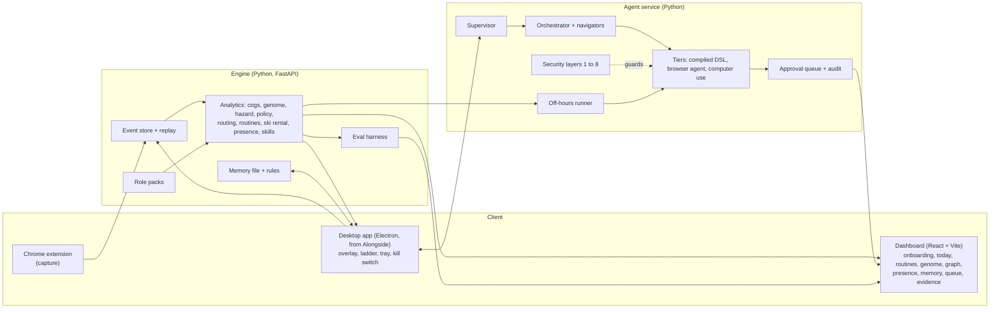

<!-- DRAFT for the lead to merge into the root README.md. Numbers come from evals/report.md generated 2026-11-07T15:42:27Z (git 2e40ca1, mock mode): re-pull before submitting. TODO = a number or fact not yet sourced. PENDING = needs the live study. -->

# Understudy

*Hack the Burgh XIII, Edinburgh, 7 to 8 Nov 2026. Targets: HRT, G-Research, Wordsmith.*

Understudy watches how people do the same task, shows exactly where a novice loses time against an expert, coaches on the real screen with help that fades as the person improves, and, only when the worker says yes to each one, takes over the repetitive parts. A memory file the worker owns, readable and editable, tunes it to them. It is built for many jobs through **role packs**: one deep (a UK benefits processor), two thin (data analyst, programmer).

What it is not: it does not claim that novices become experts. The claim is narrower: the system lifts novices on the skills it coaches, and it shows its own limits next to every number. On this build the evidence is synthetic plus four teammates (the live study is **PENDING**).

## The three-minute demo

1. **Set up (about 25 s).** Pick "UK benefits processor", answer five questions, see the memory file it wrote. Pick "Data analyst": different questions, different cogs, different risk classes, different tone.
2. **See the invisible (30 s).** The work ribbon: an expert's trace above a novice's, the gaps hatched, seconds lost beneath. The gap waterfall with intervals. The placebo (expert against expert) reads about zero. The transition graph shows the edges the novice never takes.
3. **Coach (40 s).** A teammate works a household on the sandbox calculators; the ring lands on the "Check cliff edges" button they skipped; help is lighter on the next case.
4. **Automate (35 s).** The routine card appears (what, how often, hours saved with an interval, what it touches, what it never does). The worker chooses; shadow mode matches; the agent runs it in the background; the one irreversible step lands in the queue for a click.
5. **Away (30 s).** The presence heatmap and window forecast; the start-or-wait rule; the kill switch; the morning report.
6. **Proof (20 s).** The Evidence page: calibration, risk-coverage, off-policy recovery, the injection table, the limitations register.

Exact clicks, words and fallbacks: [DEMO_SCRIPT.md](DEMO_SCRIPT.md).

## Quickstart

Needs macOS, Python 3.12 with [uv](https://docs.astral.sh/uv/), Node. Everything below runs offline in mock mode (`UNDERSTUDY_MOCK=1`): no model calls, no network, deterministic.

```bash
make setup     # uv sync; npm install for dashboard, extension and desktop; Playwright Chromium
make demo      # seeds an isolated demo home (data/demo-home, never your ~/.understudy), starts everything, opens the dashboard
make eval      # writes evals/report.json and evals/report.md (FAST=1 for a quick run); the Evidence page reads them
make test      # engine, agent, packs and dashboard tests
```

Also: `make dev` / `make stop` (services on 7700 engine, 7710 agent, 7801 to 7803 sandbox calculators, 5173 dashboard), `make redteam` (the red-team ablation table, offline), `make check` (environment check).
Extension: `cd extension && npm run build`, then load `extension/dist` unpacked in Chrome and switch capture on in its popup (it is off until you do). Its tests: `cd extension && npm test`. Evals and pack tests: `uv run pytest evals/tests packages/packs/tests -q`.
A live model is only used outside mock mode: copy `.env.example` to `.env` and set the key and model IDs (models are read from the environment and checked at boot; nothing is hard-coded).
TODO(lead): paste the test counts from the final `make test` run.

## Architecture



- **Capture** is two levels. L0 (always, once you opt in): hashed, no page text, no URLs, no field values; fields on a sensitive list are never touched. L1 (per routine you opted in): selectors and field names, values replaced by parameter slots.
- **Cogs and zones.** Events carry an enum `meta.zone` (the page region). A role pack's mapping turns events into cogs (read, enter household, read result, check cliff, reconcile, ...). The expert's checks are an ordered partial order.
- **The model proposes, code decides.** Levels, permissions, promotion, routing and gates are deterministic code. Automations run as a JSON step DSL, never generated code.
- **Eight security layers** (sanitising, quarantined reader, typed actions, action-class gate, data-flow rules, injection detector, goal-drift check, protected settings), mostly code. No allowlist; the worker keeps an optional denylist.
- **Every automation is opt-in**, one at a time, with a trust ladder (A0 to A3) that needs a stated number of clean shadow runs.

## What is real and what is synthetic

| Real | Synthetic or simulated |
|---|---|
| All the code, run locally; the capture path from a real browser through the engine (smoke-tested with a real extension, real engine process and the sandbox sites: 203 events, all schema-valid, no page text or URL stored) | Person histories (four personas, 21 days), apprentices with planted deficits, households |
| Sandbox calculators and case-note page served locally; the agent drives them in a real browser (with a scripted model in mock mode) | The calculators' quirks (we planted them) and the oracle: a simplified internal rule set, **illustrative, not law**; it agrees with PolicyEngine UK within 1 pound on only 8 of 20 households |
| One supervised real click on TextEdit (spike S2) | Red-team pages (we wrote them and the defences) |
| Model calls when not in mock mode | Everything in mock mode (scripted, deterministic) |
| The live study, once run: four teammates (**PENDING**) | Off-hours decisions are replayed on synthetic presence histories |

## What we measured, honestly

From `evals/report.md` (synthetic unless stated; intervals 95%). Each row says what it does **not** show.

| Question | Result | Does not show |
|---|---|---|
| Does the genome recover planted deficits? (n = 16 people) | Precision 92% [84.5, 98.6], recall 95% [88.6, 100]; real gap 229.6 s per case [192.7, 272.6] against placebo 7.1 s [-2.8, 18.4] and a shuffled-label null 46.2 s [-36.4, 116.9] (permutation p = 0.001) | That real people behave like our synthetic ones. Weaker on "reads the result again and again" (precision 70%) and "copies the wrong figure" (recall 71%) |
| Stuck hazard, leave one person out (4 people) | Log loss 0.436 [0.422, 0.451] against 0.509 for both baselines | Alert quality is modest: about a third of stuck events flagged; 1.21 false alarms an hour [0.95, 1.48] overshoots the 1.0 budget |
| Dignity gate | False nudges per hour 1.83 to 0.05 | Costs coverage: stuck events reached 21% to 5% |
| Off-policy evaluation (simulator, known truth) | Naive average is biased (+0.193); IPS and doubly robust recover the truth, interval coverage 96% and 88% over 24 replications | In the detailed run the intervals missed the truth (0.018); reward structure is ours |
| Review routing (900 households) | Held-out error 0.0% [0.0, 1.7] at 93.8% coverage, bound held | **Circular:** the quirks it finds are the ones we planted; the router adds little over the spread of the calculators' answers |
| Ski-rental build timing | Regret 1.332 (lambda 0.2) against 1.776 for build-at-break-even | Build-now is better at the simulated cost (1.273), and at every cost below b = 32; not uniformly best |
| Presence and start-or-wait | Interruption 2.1% against a 10% cap; 74% of idle time used (running whenever idle: 24.8% interruption) | Weekly template is poor for shift work; intervals too narrow (55% to 91% coverage); idle capacity over-estimated |
| Routine finder | After the value gate 6 of 6 proposals are planted routines (61% to 100%); recall 100% | The raw finder returns 55 clusters, 12 planted (22%) |
| Agent on the sandbox (40 runs) | 20 of 20 clean, 20 of 20 under injected failures (layout changes, one-off 503), 0 false success claims, 7 planted discrepancies flagged | Clean path passing is expected; deterministic mock model, **no real-model run in this report**; 4 failure patterns only |
| Agent-claim calibration | Brier 0.077 against 0.183 for the base rate | Simulated runs |
| Red team (42 attacks, 10 configurations) | Attack success 0.0% [0.0, 8.4] with every layer on; 100% [91.6, 100] with all off; false pauses on 31 clean pages 0.0% [0.0, 11.0] | Scripted vulnerable planner, authored attacks; task success under attack is 23.8% because a detector hit pauses the run; live-model red team is PENDING |
| Skill tracing | Mean Spearman 0.18 | **A weak result:** mastery saturates on high-volume synthetic personas |
| **Live study, n = 4** | **PENDING** | Plan committed before any data: `evals/study/ANALYSIS_PLAN.md`. Four teammates, not processors; the exact sign-flip p cannot go below 0.125 |

Skipping a step is priced in answers, not seconds, in `evals/cases/skip_consequences.json` (the genome's seconds make skipping look free). TODO(lead): quote its two headline sentences once engine-data exposes them (200 households: skipping reconcile is wrong on about 20.7, expected over which calculator is trusted; skipping the cliff check leaves an unwarned edge on 107, material on 42).

## Limitations register

The full register (47 entries today) is on the Evidence page and in `evals/report.json`. The high-severity ones:

- Almost every result is synthetic; each carries a badge. They show the methods recover what we planted.
- The live study is n = 4, teammates, none benefits processors, and has not been run.
- Real data is thin: the team's own machine timestamps only. No real benefits-processor traces.
- The oracle is a simplified internal rule set, not law.
- The hazard is evaluated on four personas; "held-out person" means one of four.
- Review routing is circular (planted quirks); its bound holds for cases like the calibration set and a new rule or calculator breaks it silently.
- Ski-rental regret is on simulated routines.
- The red-team planner is a script that follows any instruction it can see: the numbers measure what the layers stop, not how a model behaves.

Platform additions (extension, packs, evals): one Chromium build verified (158); the overlay's screen offset is calibrated at 100% page zoom on one Retina display only (not other zooms, docked DevTools, a second display or cross-origin frames); the calculators' "limited capability" question is deliberately never captured (it matches the health entry on the sensitive list); thin-pack zone selectors for real tools are untested starting points; task markers (task_start, progress, task_end) are inferred from the sandbox pages' structure and fit those pages only.

## Tracks

- **HRT, best use of data for predictions and decisions:** calibrated stuck prediction against two baselines with a false-alarm budget; review routing under a reviewer budget with a Clopper-Pearson risk bound; ski-rental build timing; the start-or-wait rule as a critical-fractile decision; off-policy evaluation with a simulator of known truth. See Evidence.
- **G-Research, make the invisible visible:** the expert's policy as aligned traces with controls (placebo, null) and a transition graph; the worker's hidden routines (work graph) and rhythm (presence heatmap) with intervals; our own failures as a limitations register.
- **Wordsmith, most complicated end-to-end browser-use workflow:** parallel navigators with a verifier, critic, approval gate and recovery; three tiers (compiled DSL, browser agent, computer use); shadow mode, background and unattended runs; code-checked completion; an injection defence that is measured with ablations.

## Disclosure: Alongside

Understudy's coach is built on **Alongside**, the author's own earlier open-source library (https://github.com/suhaanm/deepmind-hackathon, first commit **31 Oct 2026**, before this event, MIT). All Alongside code is by the author. Alongside includes code adapted from third parties; their notices travel with it (see below).

What was reused, in `apps/desktop`. Comparing the trees (7 Nov 2026): Alongside's `src/` has 303 files; **247 are carried over unchanged**, 33 are modified, 23 are not carried (Alongside's Gemini grounder, verifier, router, lesson architect, scam analyst, live wiring and Gemini port), and Understudy added its own files.
- Kept as is: the overlay (window, flight, ring, arrow, annotations), the help ladder and level engine (`src/main/teaching/levels.ts`), the learner store (the Markdown profile the worker owns, now the memory file), the verifier loop, the agency policy and audit, the agents runtime, the mocks, the dock and design primitives, the showtime and capture code.
- Modified: the actuator, agency computer-use and act-for-me, the overlay controller, tray, hotkey, settings, session, services, IPC, bus, contracts, protocol and a few tests.
- Replaced: every Gemini-specific service now goes through our model port (OpenAI primary), in `src/main/model-port` and `src/main/model-services`.
- New, Understudy's own: the engine client, DOM-based grounding (`dom-ground`), the coach poller and brain client, the HUD, proposals, the kill flag and kill switch, feature flags.
- Present but **off**: voice, wake word, live voice, scam analysis and file search. They are not part of the demo and are flagged off.

**Safety finding.** Alongside shipped with the real actuator and the multi-step `act_for_me` loop **on by default**. Its own README is inconsistent about it: one line says the loop is off and that no real click or keystroke has been run; a later line says the loop is on by default and was verified on a Calculator task and on Safari navigation. We did not rely on either claim. In `apps/desktop` both are now off by default: a real click or keystroke needs `UNDERSTUDY_REAL_ACTUATOR=1` (and the loop needs `ALONGSIDE_AGENCY_LOOP=1`), plus a frontmost-app check, a hit-test of the click point, the kill flag and an action budget. What was and was not exercised: our spike S2 performed one real click and one typed line on TextEdit with the owner present (passed); a follow-up supervised check of the agent's own actuator failed on 7 Nov (it clicked another app's window) and real runs were frozen until the guards were fixed and re-approved. TODO(lead): state the retest result and what the live demo uses.

## Credits

We read these ten projects to guide the design and re-implemented the ideas in our own code, except where `THIRD_PARTY_NOTICES.md` records a copy. Thank you to their authors. [Okidoki](https://devpost.com/software/okidoki) · [Vision OS](https://devpost.com/software/vision-os-4ckmq3) · [Bandit](https://devpost.com/software/bandit-the-only-band-you-need) · [MOA](https://devpost.com/software/moa) · [Mark8](https://devpost.com/software/mark8-go-to-market-world-model) · [Pupil](https://devpost.com/software/pupil-utzxy2) · [Drigil](https://devpost.com/software/drigil) · [Rouge](https://devpost.com/software/rouge-cm8jig) · [PodsControlMac](https://devpost.com/software/podscontrolmac-control-your-mac-with-airpods) · [Stride](https://devpost.com/software/stride-09alcg).
Ideas taken, in one line each: Mark8 (event-sourced log, pure reducer, replay, a baseline beside every prediction), Pupil (implicit reaction labels, code decides), Stride (false alarms per hour, leave-one-person-out, a limitations register), Drigil (fading ladder, dignity gate), Rouge (code-checked completion, sensitive fields as data), Vision OS (supervisor with generations and deadlines), clickyyy and Okidoki (stuck-loop detector, record once and replay), MOA (answer-key harness), Bandit (precedents become rules), PodsControlMac (agent input kept out of the human trace). TODO(lead): confirm that no file was copied from clickyyy or VisionOS (the notices table says none yet).

## Third-party notices

`THIRD_PARTY_NOTICES.md` (root) and `apps/desktop/THIRD_PARTY_NOTICES.md` (the authoritative copy for the desktop app, with the MIT text) list code adapted from farzaa/clicky (MIT) and google-gemini/gemini-live-api-examples (no licence file upstream; used only if voice is on, and it is off). PolicyEngine UK (AGPL) is used only as an optional cross-check in a separate environment and is never imported or vendored. Dependencies keep their own licences.

## Licence

TODO(owner): not chosen. Until a licence file is added, all rights are reserved.
