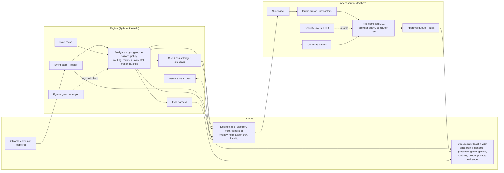

<!--
DRAFT for the lead to merge into the root README.md. Rewritten 7 Nov 2026, about 18:30 GMT, by the NARRATIVE track.

How to read this draft
- Every number carries a (source: ...) tag or sits in a table with a Source column. C-numbers (C01, C20 ...) are rows in docs/drafts/CLAIMS.md, which gives the file, the section, the status and the caveat. Keep the tags or strip them; they are accurate.
- Numbers come from evals/report.json and evals/report.md generated 2026-11-07T17:38:00Z, git 1bab986, mock mode, plus the named docs. RE-PULL before you submit: `make eval`, then compare against CLAIMS.md. The 17:38 report is known to be stale in places (its privacy section shows "Static guard: 27 violations in 172 files" inside a section marked ok, and two cost lines read "about None USD"); those lines are not quoted here.
- Status words are the catalogue's (docs/FEATURE_CATALOGUE.md, last edited 17:45): verified, built, building, proposed. Anything that is not verified or built is under "In progress", not under "What it does today".
- [LEAD: ...] = you must supply or confirm. [OWNER: ...] = only the owner can supply.
-->

# Understudy

*Hack the Burgh XIII, Edinburgh, 7 to 8 Nov 2026. Targets: HRT, G-Research, Wordsmith.*

**The problem.** Two people do the same task. One takes longer and reaches a different answer, and nobody can say where the difference comes from, because it is spread across many small choices: a check skipped, a figure copied from the wrong place, a result read three times.

**Understudy** watches how people do the same task, shows where a novice loses time and accuracy against an expert, coaches on the real screen with help that fades, and takes over repetitive work only when the worker agrees, one routine at a time. A memory file the worker owns, readable and editable, tunes it to them. It covers several jobs through role packs: one deep (a UK benefits processor), two thin (data analyst, programmer).

**What we claim, and what we do not.**
- The analysis finds the gaps we planted in synthetic apprentices and prices them in seconds, next to two controls (source: report.md "Deficit recovery" and "Controls"; C01, C03).
- The coach rings the step a synthetic novice skipped, and stays quiet for experts (source: services/engine/tests/coach/test_replay.py; C60).
- An agent completes the benefits task on our sandbox calculators, and a code check, not the model, decides whether it finished (source: report.md "Agent runs on the sandbox"; C20 to C26).
- **Not claimed:** that coaching helps a person. The live study with four teammates has not been run, and the simulated study (language-model participants, not people) hit a floor, so it says nothing about the coach yet (source: report.md "Live study"; evals/study_sim/PLAN_RUN5.md section 1; C70, C72). The intended effect is that novices need less help over time; that has not been measured. We do not claim that novices become experts.

## Where it stands

Status words are those of `docs/FEATURE_CATALOGUE.md` at 7 Nov 17:45 GMT. verified: the lead saw it work end to end. built: built and tested by its track, not yet seen end to end. building: not finished. All results below are on synthetic or sandbox data unless a row says otherwise.

| | What | Status | Evidence label |
|---|---|---|---|
| **What it does today** | Work genome: aligns a novice's steps to the nearest expert's and prices each gap in seconds | verified | synthetic |
| | Controls: expert against expert, and a shuffled-label null | verified | synthetic |
| | Stuck model: predicts "no progress in the next minute" | verified | synthetic, n = 4 people |
| | Fading help levels (L1 to L4) decided by code, with mastery that decays | verified | synthetic |
| | Live coach brain: one decision at a time from live events | verified | synthetic replay |
| | Benefits agent on the sandbox calculators: three calculators, cliff check, reconcile, case note, a gate on the real submit button | verified | sandbox; real-model runs are small |
| | Eight security layers: injection pause, action classes, approval queue, hash-chained audit, kill flag, no allowlists | verified | red team, synthetic |
| | Shadow mode to approval: a routine earns autonomy by matching what the worker does | verified | synthetic |
| | Evidence page and `make eval` | verified | n/a |
| **Built and tested, not yet seen end to end** | Gap decomposition; dignity gate and bandit; routines finder; presence model; review routing and trust ladder; on-screen annotations (the lead viewed screenshots); background agents; overnight automations; proactive briefing; git analysis; local model; privacy spine (with a known gap, below) | built | synthetic |
| **In progress** | Cue (stuck rescue) and the independence score; Growth screen (shows labelled example data until the assist ledger is wired); awareness and screen glances; model routing across OpenAI, Gemini, a local model and ElevenLabs (bake-off pending); independent verifier; calendar layer; role studies; more realistic synthetic data; LLM explainer with a number check; ML v2; new logo and hold-to-talk activation; the simulated study (running) | building | simulated or synthetic, pending |
| | Computer use on the real screen, including the benefits task | building; **not yet working** | 3 runs, 0 pointer actions (C27) |
| | Live voice | proposed | n/a |

## The three-minute demo

Runs with `make demo`, in mock mode, wifi off. Exact clicks, words and fallbacks: [DEMO_SCRIPT.md](DEMO_SCRIPT.md).

1. **The problem and the one-line product** (20 s).
2. **See the invisible** (30 s). The work ribbon: an expert's trace above a novice's, gaps hatched, seconds lost beneath, with both controls. Synthetic, and badged.
3. **Coach, and Cue** (45 s). A synthetic novice skips the cliff check; the ring lands on that button once. Cue's one-question rescue is shown only if the lead has confirmed it end to end.
4. **Growth** (17 s). How much less help a worker needs over time, with intervals. It shows labelled example data until the assist ledger is wired.
5. **Automate** (25 s). A routine card; the worker chooses "Watch first"; a recorded mock-mode run; the one irreversible step waits in the queue for a click.
6. **Privacy** (18 s). The egress ledger: every call from the new layers to a remote model, listed as sent. In mock mode none leave the laptop.
7. **Proof and limits** (25 s). The Evidence page, ending on what it does not show.

## Quickstart

Needs macOS, Python 3.12 with [uv](https://docs.astral.sh/uv/), and Node. Everything below runs offline in mock mode (`UNDERSTUDY_MOCK=1`): no model calls, no network, deterministic.

```bash
make setup      # uv sync; npm install for dashboard, extension and desktop; Playwright Chromium
make demo       # seeds an isolated demo home (data/demo-home, never your ~/.understudy), starts engine, agent, sandbox sites and dashboard, opens the dashboard
make preflight  # green, amber or red for every part of the demo; never prints a key
make eval       # writes evals/report.json and evals/report.md (FAST=1 for a quick run); the Evidence page reads them
make test       # engine, agent, packs and dashboard tests
```

Also: `make dev` and `make stop` (engine 7700, agent 7710, sandbox calculators 7801 to 7803, dashboard 5173), `make redteam` (the scripted red-team table, offline).
`make demo` does not start the desktop coach or load the browser extension. Extension: `cd extension && npm run build`, load `extension/dist` unpacked in Chrome, switch capture on in its popup (it is off until you do). Desktop coach: `cd apps/desktop && npm run dev` (electron-vite); [LEAD: the exact environment flags and the permission steps, and whether the demo needs it].
A live model is used only outside mock mode: copy `.env.example` to `.env` and set the key and model IDs. Model IDs are read from the environment and checked at boot; nothing is hard-coded.
[LEAD: paste the test counts from the final `make test` and the typecheck. Not quoted here because none was available to this track.]

## Architecture



- **Capture** has two levels. L0 (always, once you opt in): hashed identifiers, no page text, no URLs, no field values; fields on a sensitive list are never touched. L1 (per routine you opted in): selectors and field names, with values replaced by parameter slots. The real extension in a real browser produced ten schema-valid events with no page text or URL, and typing in a password form produced zero events (source: docs/SPIKES.md S3; C62).
- **Cogs and zones.** Events carry an enum `meta.zone` (the page region). A role pack maps events to cogs (read, enter household, read result, check cliff, reconcile ...). The expert's checks are an ordered partial order.
- **The model proposes, code decides.** Levels, permissions, promotion, routing and gates are deterministic code. Automations run as a JSON step language, never generated code.
- **Eight security layers** (sanitising, quarantined reader, typed actions, action-class gate, data-flow rules, injection detector, goal-drift check, protected settings), mostly code. No allowlist; the worker keeps an optional denylist.
- **Every automation is opt-in**, one at a time, with a trust ladder (A0 to A3) that needs a stated number of clean shadow runs. A3 is a target, not a result (source: report.md limitation `ana-trust-ladder`; C17).
- **The agent's "done" is checked by code.** The final page must contain the requested result; a model's claim of success is not accepted (source: report.md "Agent runs on the sandbox"; C24).

## What is real and what is synthetic

| Real | Synthetic or simulated |
|---|---|
| All the code, run locally. The capture path was checked once with a real extension in Chromium 158 against a stub server (ten events) | Person histories (four personas, 21 days), apprentices with planted deficits, households, calendars, commits |
| Three sandbox calculators and a case-note page, served locally. The agent drives them in a real browser | The calculators' quirks (we planted them) and the oracle, a simplified internal rule set, **illustrative, not law**; it agrees with PolicyEngine UK within 1 pound on 8 of 20 households (source: docs/SPIKES.md S4; C64) |
| Model calls outside mock mode: the real-model agent runs (20 households per condition) and the real-model red team (42 cases, 3 repeats), both small | Everything in mock mode: scripted and deterministic. The recorded demo run is a replay of a mock-mode run on household hh_0004 (source: data/golden/benefits_golden.json; C66) |
| One supervised real click and one typed line on TextEdit, with the owner present (spike S2, passed) | Red-team pages: we wrote them and the defences |
| | Study participants in the simulated study: language models, **not people** |
| | The live study: **not run** |

## What we measured

From `evals/report.md` (generated 17:38 GMT, mock mode). Origin is synthetic unless the row says otherwise; intervals are 95%. The right-hand column says what a row does not show.

### The analysis (G-Research, HRT)

| Question | Result | Does not show | Source |
|---|---|---|---|
| Does the alignment find the deficits we planted? Synthetic, 16 people (5 planted deficits over 32 novice cases) | Precision 92% [84.5, 98.6], recall 95% [88.6, 100.0] | That real people behave like our apprentices. Weak on "reads the result again and again" (precision 70% [40.0, 94.1], 13.5 s too high) and "copies the wrong figure" (recall 71% [33.3, 100.0]) | report.md "Deficit recovery"; C01, C02 |
| Is the gap an artefact? Synthetic, 24 people | Real novice-to-expert gap 229.6 s per case [192.7, 272.6]; expert against expert 7.1 s [-2.8, 18.4]; shuffled-label null 46.2 s [-36.4, 116.9]; permutation p = 0.001 | The null is not exactly zero (it is about 20% of the real gap) because nearest-reference matching is not symmetric. The real gap sits above both controls | report.md "Controls"; C03 |
| Can it predict "no progress in the next 60 s"? Synthetic, leave one person out, n = 4 people | Log loss 0.436 [0.422, 0.451] against 0.509 [0.496, 0.524] (time since progress) and 0.509 [0.497, 0.524] (base rate) | "Held-out person" means one of four. About a third of stuck events are flagged (33% [27.5, 38.6]); false alarms are 1.21 an hour [0.95, 1.48] against a budget of 1.0. It predicts "no progress", not confusion | report.md "Stuck hazard"; C04, C05 |
| Does a dignity gate cut false nudges? Synthetic, n = 4 people | False nudges per hour 1.83 to 0.05; stuck events reached 21% to 5%; median delay 30 s to 60 s | It buys quiet with coverage. The report's table gives no interval for these | report.md "Coaching dignity gate"; C06 |
| What does skipping a step cost, in answers? Synthetic, 200 households | Skipping reconcile is wrong on about 20.7 of 200 (10.3% [7.8, 13.0], expected over which calculator is trusted). Skipping the cliff check leaves a nearby edge unwarned on 107 of 200 (53.5% [46.6, 60.3]), a move of more than 50 pounds a month on 42 | The calculators' quirks are ours and the oracle is a simplified rule set, so this shows the method, not real calculators. In seconds, skipping looks free, which is why we price it in answers | evals/cases/skip_consequences.json; C61 |
| Does the coach ring the right step? Synthetic apprentices, 48 cases | 14 of 14 cases that skipped the cliff check were ringed; no expert was prompted; no ring on a clean case | The skip is planted, so a clean score is expected. It is a test assertion, not a report section | services/engine/tests/coach/test_replay.py; C60 |
| Review routing under a budget? Synthetic, 900 households | Held-out error 0.0% [0.0, 1.7] at 93.8% coverage; the bound held | **Circular:** it finds the quirks we planted, and the plain spread of the calculators' answers does almost as well | report.md "Review routing"; C09 |
| When to build an automation? Synthetic, 4,000 simulated routines | Regret against hindsight 1.332 [1.322, 1.342] with predictions (lambda 0.2), against 1.776 [1.765, 1.786] for building at break-even | Building at once is better at the simulated cost (1.273 [1.257, 1.290]) and at every cost up to 16 runs; the rule only wins at 32 | report.md "Ski-rental build timing"; C10 |
| When may a background run start? Synthetic, 4 personas, 21 days each | Interruption 2.1% with the start-or-wait rule against 24.8% for running whenever idle five minutes (cap 10%); 74.2% of idle time used against 90.2% | A fixed overnight window interrupts 2.0% but uses 43.0%. The weekly map is worse than a plain baseline for the shift worker; the intervals are too narrow; idle capacity is over-estimated | report.md "Presence and window forecast"; C11 |
| Does the routine finder propose real routines? Synthetic, 4 personas | After the value gate, 6 of 6 proposals are planted routines [61.0, 100.0]; recall 100% [74.1, 100.0] | The raw finder returns 55 clusters and only 12 are planted routines (22% [12.9, 34.4]) | report.md "Routine finder"; C12 |
| Do the off-policy estimators recover a known truth? Simulator, 24 replications of 2,400 decisions | Naive average is biased (mean error +0.193, interval covers the truth 0% of the time); IPS covers 96%, doubly robust 88% | In the detailed 6,000-decision run every interval missed the true value (0.018). The reward structure is ours | report.md "Off-policy evaluation"; C08 |
| Skill tracing | Mean Spearman 0.18 across 4 personas | **A weak result:** mastery saturates on high-volume synthetic personas, so it cannot follow the planted learning curve | report.md "Skill tracing"; C07 |
| What could a study of n = 4 detect? Monte Carlo of the pre-registered analysis, 10,000 replications | At n = 4 the smallest possible exact p is 0.125. For a medium effect the interval excludes zero 4.4% of the time at n = 4 and 27.3% at n = 16 | A property of the design under our assumptions, not a result about people | report.md "Study power"; C16 |

### The agent and its defences (Wordsmith)

| Question | Result | Does not show | Source |
|---|---|---|---|
| Does the agent finish on the sandbox, mock model? 20 households, synthetic | Clean path 20 of 20 [0.84, 1.00]; with failures injected (layout changes, one-off 503) 20 of 20 [0.84, 1.00], 15 of 20 needing the browser-agent tier; 0 false claims; 7 of 20 planted calculator discrepancies flagged | Says little: the clean path is the path the sandbox was written for. Four failure patterns only | report.md "Agent runs on the sandbox"; C20 to C22 |
| Does it finish with a real model? **Real model, small n:** 20 households per condition, browser-agent tier forced | Clean 18 of 20 [0.70, 0.97], 0 false claims; after a layout change 20 of 20 [0.84, 1.00] | One model family, one prompt; cached prompts mean fewer independent samples than runs | report.md; C23 |
| What happens on a one-off error page? Real model, 20 households | **0 of 20** [0.00, 0.16]. It said it was finished in 20 of 20 runs and all 20 claims were false; the code check caught every one | This is why code decides. We then changed the planner's inputs and re-ran **the same condition**: 10 of 10 [0.72, 1.00], 0 false claims. **In-sample**, 10 runs (a budget stop dropped the rest); it does not show the fix generalises | report.md; C24, C25 |
| Does it resist injected pages? Real model, 20 households | The detector paused 20 of 20 runs before the planner acted; 0 of 20 attacks succeeded | Task success is 0 by design (a paused run does no task). We wrote the injection pages | report.md; C26 |
| Computer use on the real screen? | **Not demonstrated** on the benefits task: 3 runs against a simulated actuator made 0 pointer actions | The model declined at step 1 because tier-3 goals carry no household values by design. A fix (fact handles) is being built (source: docs/REQ7_PLAN.md section 1; C27) | report.md; C27 |
| Does the layered defence stop a scripted attacker? Synthetic, 42 attacks, 10 configurations | Attack success 0.0% [0.0, 8.4] with every layer on, 100.0% [91.6, 100.0] with all off; false pauses on 31 clean pages 0.0% [0.0, 11.0] | The planner is a script that follows any instruction it sees. Task success under attack is 23.8% [13.5, 38.5] because a detector hit pauses the run. Layers overlap: removing the detector alone did not let an attack through | report.md "Red team with ablations"; C30 |
| Does it stop a real model's attacks? Real model, 42 cases, 3 repeats each | 0 of 126 runs with every layer on [0.0, 8.4]; 5 of 126 (4.0% [1.0, 14.7]) with all layers off. Task success 22% [12.3, 36.8] against 84% [70.3, 92.2] | **The intervals overlap:** this measures what the layers cost, not that they prevent attacks. The attacks were written by the team that wrote the defences | report.md "Red team with a real model"; C31 |
| Can a claimed success be flagged? Synthetic, 600 runs | Brier 0.077 [0.066, 0.090] against 0.183 for the base rate. Real model: 68 claims from 20 households, Brier 0.004 against 0.294 | The real-model false claims are one family of failure (a finish claim on an error page), so a one-line rule also catches them. Code still decides success | report.md "Agent-claim calibration"; C14 |
| Do planted strings reach a model? Synthetic canaries, 8 seeds per flow | 0 of 11,336 planted tokens reached the model port across 80 runs of 10 flows (136 requests); 0 leaks in 80 log, audit and queue files; 11 of 11 negative controls behaved as required | The honest unit is the run, not the token: 0 of 80 runs gives a one-sided 95% upper bound of 3.7% (source: evals/review/privacy_honesty.md M5). Exact strings only, no paraphrases. Flows that registered no code are not counted as passed | report.md "Privacy layer"; C40 |

### Layers added after kickoff (all synthetic, development sets, flagged off by default)

| Layer | Result | Does not show | Source |
|---|---|---|---|
| Git habits (programmer role), 120 planted learner-habit pairs | Precision 100% (116 of 116) [96.8, 100.0], recall 97% (116 of 120) [91.7, 98.7]; placebo false flags 1% (5 of 480) | Planted habits are large and independent; at 25% of the planted strength recall falls to 19%. No study of whether following a suggestion helps | report.md "Git habits"; C50 |
| Calendar layer, 28 synthetic people | Planted problems found: precision 93.9%, recall 98.2%; suggestions against the planted cause 96.4% and 89.9%; 0 of 24 expert weeks flagged | The expert reference comes from the template that also sets the targets. Never run on a live tenant; the Microsoft Graph adapters were tested on recorded fake responses only | report.md "Calendar layer"; C51 |
| Proactive briefing, 145 decisions | The judge's cards were worth surfacing in 101 of 124 (precision 82% [70.4, 89.9]); recall 86% [75.5, 93.2]; cap of 3 cards never broken; nothing fired unprompted | Development-set figures on the same personas the rules were revised against; the worker's accept rate is simulated | report.md "Proactive cards"; C52 |
| Local model digests (Qwen2.5-7B, 4-bit), 98 held-out items per field | Category: 91.8% [84.7, 95.8] against rules 77.5% [68.3, 84.7] for commits, 95.9% [90.0, 98.4] against 81.6% [72.8, 88.0] for events. The other three fields showed no clear difference, so rules ship | Invented items, labels and rules written by the same author. A planted instruction in the input can steer the model's labels (with one planted line, a model-for-everything run followed it on 19 of 19 commit categories; the keyword rules on none) | report.md "Local model digests"; C53, C54 |

### The studies with people, and the simulation

| Study | State | Source |
|---|---|---|
| **Live study, n = 4** (teammates, none of them benefits processors) | **NOT RUN.** The report shows no numbers for it. The analysis plan was committed before any data: `evals/study/ANALYSIS_PLAN.md` | report.md "Live study"; C70 |
| **Simulated participants (language model), not people** | Design: 16 coached participants and an 8-participant sham arm with the coach silent, driving the real extension, engine and coach brain, pre-registered in `evals/study_sim/PLAN.md` before any model-driven run. Three earlier attempts were stopped for harness changes (a typed-value bug, freezing the pipeline, adding an event export) before any participant data was analysed. The pre-registered run (run 4, fast model, 24 participants planned) **hit the floor**: most post-tests ended at the 60-action cap with no calculation done, so scores are almost all zero in both arms and say nothing about the coach. A second, exploratory run (the same model with its reasoning effort raised to low, up to 12 participants, a US$6 cap) is pre-registered separately and starts only after run 4's analysis is written. The build machine was heavily loaded during these runs, which affects timings | evals/study_sim/PLAN.md; PLAN_RUN5.md section 1 and Amendments 1 and 2; NOTE.json of aborted runs 1 to 3; C71 to C73. [LEAD: replace this row with the final numbers and intervals, and the state of run 5, when they land in the report] |

## Limitations we state up front

From the limitations register in `evals/report.json` (124 entries at 17:38 GMT: 34 high, 69 medium, 21 low; source: C17). The high-severity ones that matter most:

1. **Almost every number is from synthetic data we generated** (apprentices, personas, calendars, commits, households). Each result carries a badge. They show that our methods recover what we planted, not that real workers behave this way. (`eval-synthetic`)
2. **Nobody has used it in a study.** The live study (four teammates, none a benefits processor) has not been run, and with n = 4 the smallest possible exact p is 0.125. The simulated study uses language-model participants, not people, and its pre-registered run hit a floor. (`eval-study-n4`, `eval-study-not_run`, `ana-study-n4`)
3. **There is no real benefits-processor data.** The only real signal is our own machine timestamps. (`eval-thin-real-data`)
4. **The agent is scored against a simplified rule set, not the law.** It agrees with PolicyEngine UK within 1 pound on 8 of 20 households, and the three calculators are sandbox sites with quirks we planted. (`eval-oracle`, `eval-sandbox-sites`)
5. **A real model declared success on an error page in 20 of 20 runs and was wrong every time.** Code caught all 20. Our fix was tested only on the same condition, 10 runs (in-sample). (`eval-agent-live-glitch-false-claims`, `eval-agent-live-fix-in-sample`)
6. **Computer use does not yet work on the benefits task** (3 runs, 0 pointer actions). One supervised real click on TextEdit passed; the agent's own actuator then failed its first supervised check, by clicking another app's window, and real clicks stay off until it is retested with the owner present. (`eval-agent-live-tier3`; docs/SPIKES.md S2 follow-up)
7. **The red-team attacks were written by the team that wrote the defences.** In the real-model run the intervals overlap, so it measures what the layers cost, not that they prevent attacks. (`eval-redteam-live-reading`, `scripted_planner`)
8. **Two results are weak or circular.** The stuck model flags about a third of stuck events on four synthetic personas, with false alarms over budget (1.21 an hour against 1.0); review routing finds the quirks we planted. (`ana-hazard-people`, `ana-hazard-alerts`, `ana-routing-circular`)
9. **The privacy ledger does not cover everything.** It lists calls from the Python services and the new layers. Model calls the worker asked for are recorded as metadata only, a screen frame that is allowed to leave is raw (the guard does not redact pixels), and the older desktop code inherited from Alongside could still send screenshots and file text to OpenAI and Gemini when an independent reviewer looked (finding H6); decision D38 turns those paths off by default. [LEAD: confirm D38 has landed and re-run `evals/review/privacy`.] (`prv_worker_requested`, `img_raw_by_nature`, `img_old_ts_provider_code`)

## Independent review

Two independent review passes were run by separate Claude Sonnet 5.5 agents (not human security researchers), read-only apart from `evals/review/`, with hermetic reproducers. State below is as of 17:55 to 17:56 GMT on 7 Nov. [LEAD: re-run and update before submitting.]

| Review | Found | State at the end of the review | Source |
|---|---|---|---|
| Privacy and honesty (`evals/review/privacy_honesty.md`) | No critical finding; 6 high, 9 medium, 8 low | High findings: voice sent free text to a third party (fixed); model calls missing from the ledger by default (fixed); live study could be fed from simulated data (fixed); any website could write to worker-only routes and set the kill switch (fixed on the engine, **open on the agent service**); legacy desktop code sends screenshots and file text with no gate (**open**) | C42 |
| Safety of the real actuator (`evals/review/safety_actuator.md`) | 18 findings: 1 critical, 8 high, 1 medium-high, 7 medium, 1 low | 15 fixed in code (some still need one real-desktop confirmation); **3 open**: the kill flag and queue approval have no authentication (S-02), the actuator check can report ok with no read-back (S-08), approvals are weak (S-11). The critical one was that the action gate could not see what a tier-3 click did (fixed) | C43 |


## Tracks

- **HRT, best use of data for predictions and decisions.** A stuck prediction that beats two baselines on log loss, with a stated false-alarm budget and the shortfall against it (C04, C05); review routing with a risk bound (circular, stated as such, C09); build timing by ski rental, with the cases where it loses (C10); the start-or-wait rule for background runs (C11); off-policy evaluation against a simulator with known truth (C08); calibration of "this success claim is false" (C14). Every one is synthetic and labelled.
- **G-Research, make the invisible visible.** The expert's policy and the novice's gaps as aligned traces priced in seconds, with a placebo and a shuffled-label null (C01, C03); the cost of skipping a step in answers, not just seconds (C61); a transition graph; the worker's hidden routines (C12) and weekly rhythm (C11) with intervals; and our own failures, as a limitations register with 124 entries (C17).
- **Wordsmith, most complicated end-to-end browser-use workflow.** Three sandbox calculators worked in parallel with a verifier, critic, approval gate and recovery; three tiers (compiled script, browser agent, computer use); shadow mode and background runs; completion checked by code; and an injection defence measured with ablations. Real-model results are small and include a failure we publish: 0 of 20 on a one-off error page (C23 to C27, C30, C31). The computer-use tier is not yet working on this task.
- **Also entering (MLH categories).** OpenAI: the planner, fast and computer-use calls behind one model port, used in the real-model rows above; model IDs come from the environment. Gemini API: the model bake-off and screen-glance routes are building; no Gemini speed or accuracy figure is claimed until the bake-off lands in the report. ElevenLabs: a voice route that speaks only fixed lines by id, ledgered, flag off by default, cached audio for the offline demo [LEAD: confirm status]. Auth0: a thin sign-in behind an interface with a local fallback, never on the demo's critical path [OWNER: whether the tenant exists]. DEV Writing Challenge: [DEV_POST.md](DEV_POST.md).

## Disclosure: Alongside

Understudy's coach is built on **Alongside**, the author's own earlier open-source library (https://github.com/suhaanm/deepmind-hackathon, first commit **31 Oct 2026**, before this event, MIT). All Alongside code is by the author. Alongside includes code adapted from third parties, and their notices travel with it (see below). [OWNER: whether an organiser was asked about reuse; this is an open question in docs/IDEA_BOARD.md.]

What was reused, in `apps/desktop`. Comparing the `src/` trees by file hash on 7 Nov 2026 at about 18:15 GMT (C65; the desktop track is still editing, so recompute at the freeze with the snippet in CLAIMS.md): of Alongside's 303 source files, **205 are byte-identical**, 70 are modified and 28 were not carried over; 313 files are new, written for Understudy.
- **Kept as is:** the help-level engine and learner store (`src/main/teaching`, including `levels.ts`), the agency policy and audit (`src/main/agency/policy.ts`, `audit.ts`), the screen-capture helpers (`src/main/capture`), the agents runtime, the Showtime scripted walkthrough, and most of the dock and onboarding screens.
- **Modified:** the actuator, agency computer-use and act-for-me, the overlay scene and annotation shapes and labels (restyled for the new on-screen look), tray, hotkey, settings, session, services, IPC and bus.
- **Not carried over:** Alongside's Gemini services (grounder, verifier, router, lesson architect, scam analyst, Live wiring) and its Gemini port. Their jobs now go through our model port, in `src/main/model-port` and `src/main/model-services`.
- **New, Understudy's own:** the engine client, DOM-based grounding (`dom-ground`), the coach poller and brain client, the HUD, proposals, the kill flag and kill switch, feature flags, and the in-progress Cue, awareness and Live code.
- **Present but off:** voice, wake word, live voice, scam analysis and file search. They are not part of the demo.

**Safety finding.** Alongside shipped with the real actuator and the multi-step `act_for_me` loop **on by default**, and its own README is inconsistent about it: one line says the loop is off and that no real click or keystroke has been run; a later line says the loop is on by default and was checked on a Calculator task and on Safari navigation. We did not rely on either. In `apps/desktop` both are off by default: a real click needs `UNDERSTUDY_REAL_ACTUATOR=1` (and the loop needs `ALONGSIDE_AGENCY_LOOP=1`), a frontmost-app check, a hit test of the click point, the kill flag and an action budget. What was and was not exercised: spike S2 performed one real click and one typed line on TextEdit with the owner present (passed, mapping error 0.0 points); a follow-up supervised check of the agent's own actuator **failed** on 7 Nov (it reported ok while the click landed in another app's window), and real runs were frozen. The guards were then rebuilt and reviewed; the fixes are tested against a fake desktop only, and the ladder of supervised real runs (R0 to R4) has not been run. [LEAD: state the retest result, if any, before submitting.] (source: docs/SPIKES.md S2 follow-up; docs/REQ7_PLAN.md section 1; evals/review/safety_actuator.md; C63)

## Credits

We read these ten projects to guide the design and re-implemented the ideas in our own code, except where `THIRD_PARTY_NOTICES.md` records a copy. Thank you to their authors. [Okidoki](https://devpost.com/software/okidoki) · [Vision OS](https://devpost.com/software/vision-os-4ckmq3) · [Bandit](https://devpost.com/software/bandit-the-only-band-you-need) · [MOA](https://devpost.com/software/moa) · [Mark8](https://devpost.com/software/mark8-go-to-market-world-model) · [Pupil](https://devpost.com/software/pupil-utzxy2) · [Drigil](https://devpost.com/software/drigil) · [Rouge](https://devpost.com/software/rouge-cm8jig) · [PodsControlMac](https://devpost.com/software/podscontrolmac-control-your-mac-with-airpods) · [Stride](https://devpost.com/software/stride-09alcg).
Ideas taken, in one line each (source: docs/REFERENCES.md): Mark8 (event-sourced log, pure reducer, replay, a baseline beside every prediction), Pupil (implicit reaction labels, code decides), Stride (false alarms per hour, leave-one-person-out, a limitations register), Drigil (fading ladder, dignity gate), Rouge (code-checked completion, sensitive fields as data), Vision OS (supervisor with generations and deadlines), clickyyy and Okidoki (stuck-loop detector, record once and replay), MOA (answer-key harness), Bandit (precedents become rules), PodsControlMac (agent input kept out of the human trace). Okidoki's repository could not be cloned (404), so its notes come from its Devpost text only (source: docs/DECISIONS.md, 7 Nov 14:19 entry).

## Third-party notices

`THIRD_PARTY_NOTICES.md` (root) and `apps/desktop/THIRD_PARTY_NOTICES.md` (the authoritative copy for the desktop app, with the MIT text) list code adapted from farzaa/clicky (MIT) and google-gemini/gemini-live-api-examples (no licence file upstream; used only if voice is on, and it is off). Two modules from the MIT Windows fork of Clicky are lifted into `vendor/clicky/` with headers and the full MIT text. The Sentient OS design (AGPL-3.0) was reimplemented from the owner's prose notes; no code was copied. PolicyEngine UK (AGPL) is used only as an optional cross-check in a separate environment and is never imported or vendored. No file has yet been copied from clickyyy or VisionOS (the notices table says none). Dependencies keep their own licences. (source: THIRD_PARTY_NOTICES.md; docs/DECISIONS.md REQ-2)

## Licence

[OWNER: not chosen. Alongside is MIT; this repository has no licence file yet. Until one is added, all rights are reserved.]
